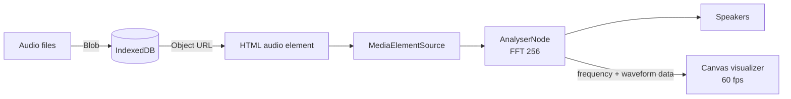

<div align="center">

# 🎧 MELO

**Your music, your vibe. A private, in-browser music player with a live audio visualizer.**


**[🚀 Live demo](https://gaganajain.github.io/MELO---YOUR-/)**

</div>

---

## 📌 About

**MELO** turns your browser into a music player for the songs you already own. Drag in MP3, WAV, OGG, M4A or FLAC files and play them with a smooth, colourful interface and a real-time visualizer that reacts to the beat.

No sign-up, no uploads and no server. Your songs are stored in your browser's IndexedDB, so they're still there next time you open MELO.

No songs to hand? Click **"load 3 demo tracks"**. MELO composes three short tracks right in your browser with the Web Audio API.

## ✨ Features

| | Feature | Details |
|---|---|---|
| 📂 | **Drag & drop** | Add any number of audio files; `Artist - Title.mp3` names are split automatically |
| 💾 | **Remembers your library** | Songs are saved in IndexedDB and survive page reloads |
| 🌈 | **Live visualizer** | Three modes: frequency **Bars**, oscilloscope **Wave**, radial **Ring** |
| 🎨 | **Adaptive colours** | Each song gets its own accent colour theme |
| 🔀 | **Shuffle & repeat** | Shuffle, repeat all and repeat one |
| ♥ | **Liked songs** | Like songs and filter the library to just your favourites |
| 🔍 | **Search** | Filter by title or artist as you type |
| ⌨️ | **Keyboard shortcuts** | Control everything without the mouse |
| 📱 | **Media keys** | Media Session API support for headset buttons and lock-screen controls |
| 🎹 | **Demo tracks** | Three tracks synthesised in-browser (OfflineAudioContext → WAV) |
| 📐 | **Responsive** | Two-column layout on desktop, stacked on mobile |

## ⌨️ Keyboard Shortcuts

| Key | Action |
|---|---|
| `Space` | Play / pause |
| `←` / `→` | Previous / next song |
| `↑` / `↓` | Volume up / down |
| `S` | Toggle shuffle |
| `R` | Cycle repeat: off → all → one |
| `L` | Like / unlike the current song |

## 🖼️ Preview

```
┌──────────────────────┐ ┌──────────────────────────────────────────┐
│ ♪ MELO               │ │  ▂▃▅▇█▇▅▃▂  ( N )  ▂▃▅▇█▇▅▃▂            │
│ your music, your vibe│ │                                          │
│ [＋ Add songs      ] │ │  Neon Drive                          ♡   │
│ (All) (♥ Liked) [🔍] │ │  MELO Demo                               │
│ ▮▮ Neon Drive        │ │  0:05 ━━━━━━●──────────────── 0:16       │
│ 2  Lo-fi Sunday      │ │       🔀   ⏮   ( ❚❚ )   ⏭   🔁           │
│ 3  Pixel Hearts      │ │  🔊 ━━━━━━●──     (Bars) (Wave) (Ring)   │
└──────────────────────┘ └──────────────────────────────────────────┘
```

## 🚀 Run Locally

```bash
git clone https://github.com/Gaganajain/MELO---YOUR-.git
cd MELO---YOUR-
python -m http.server 8000
```

Open http://localhost:8000 and drop in some songs.

## 🌐 Deploy on GitHub Pages

1. Open **Settings → Pages** in this repository.
2. Choose **Deploy from a branch**, branch `main`, folder `/ (root)`, and save.
3. MELO will be live at `https://gaganajain.github.io/MELO---YOUR-/`.

## 🧱 How It Works



```
MELO---YOUR-/
├── index.html   # Layout: library panel + player
├── style.css    # Glassmorphism theme, sliders, responsive layout
└── app.js       # Library, IndexedDB, playback, visualizer, demo synth
```

## 🔮 Roadmap

- Read ID3 tags and embedded album art
- Playlists and drag-to-reorder
- Equalizer with BiquadFilter nodes
- Installable PWA with offline support

## 👩‍💻 Author

**Gagana Jain A** · [GitHub](https://github.com/Gaganajain)

⭐ If you enjoy MELO, give it a star!
